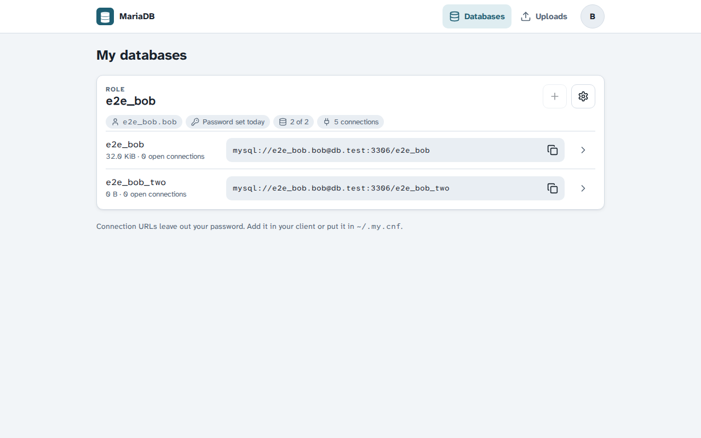

# MariaDB Server for Cloudron

A standalone MariaDB 11.8 server for clients outside of Cloudron, with a web panel to manage roles and databases.

* Connections are TLS 1.3 only, using the app domain's certificate
* Remote access is blocked until a network is added to the allowlist
* Each role only gets access to its own databases, every owner has an own login
* Sign in with Cloudron, admins manage roles, databases and allowed networks
* Snapshots, downloads and restores of databases, import of SQL dumps

## Install

In Cloudron, open 'Add custom app' and enter `https://raw.githubusercontent.com/BrutalBirdie/MariaDB-Cloudron-App/master/CloudronVersions.json`.

Changes per version are in the [releases](https://github.com/BrutalBirdie/MariaDB-Cloudron-App/releases).
